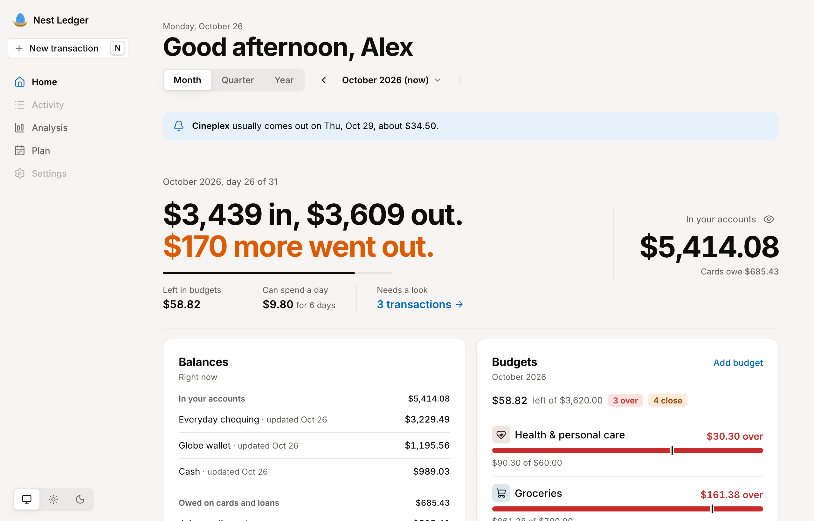
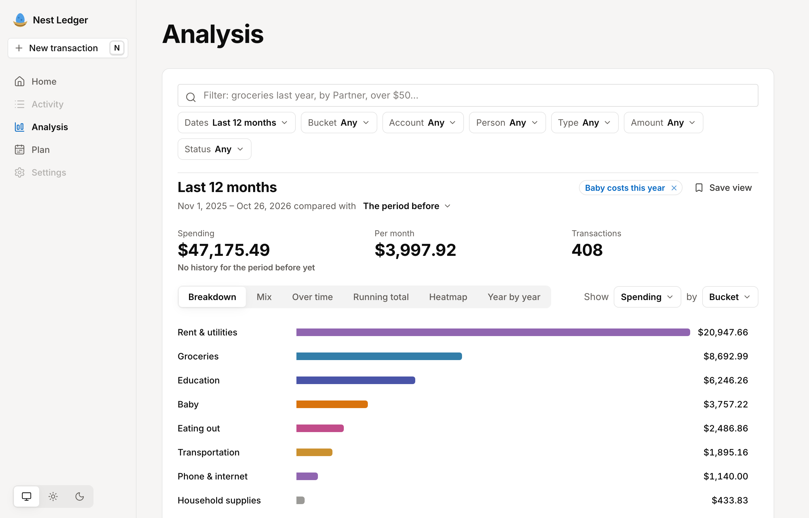
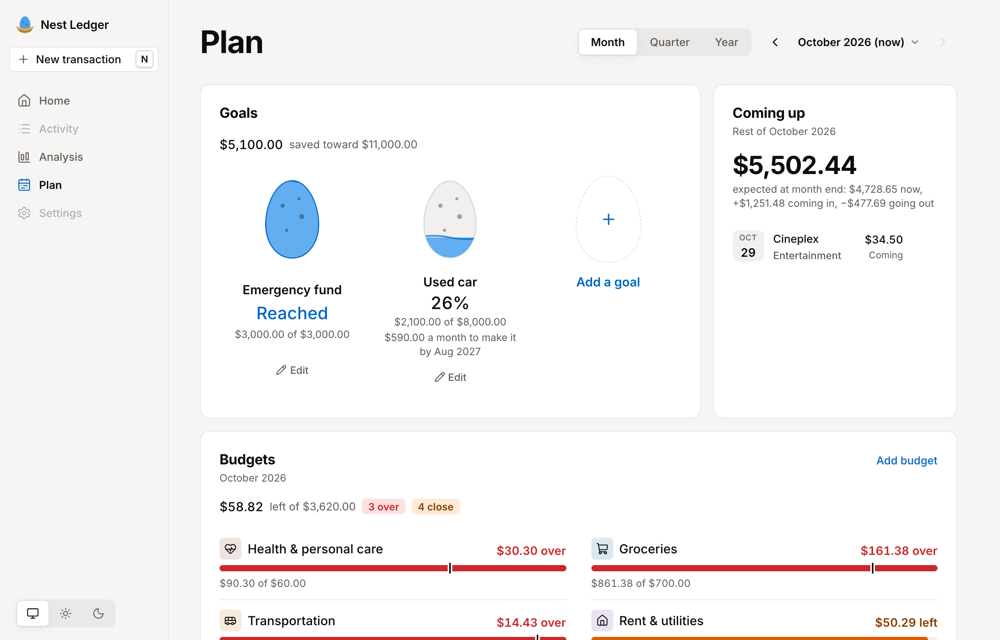
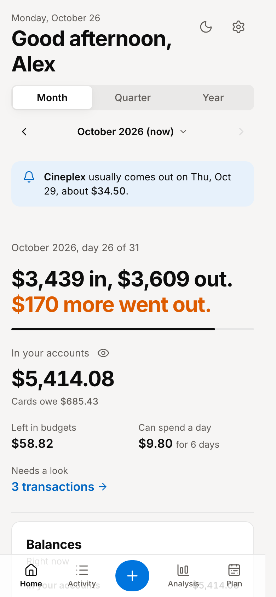
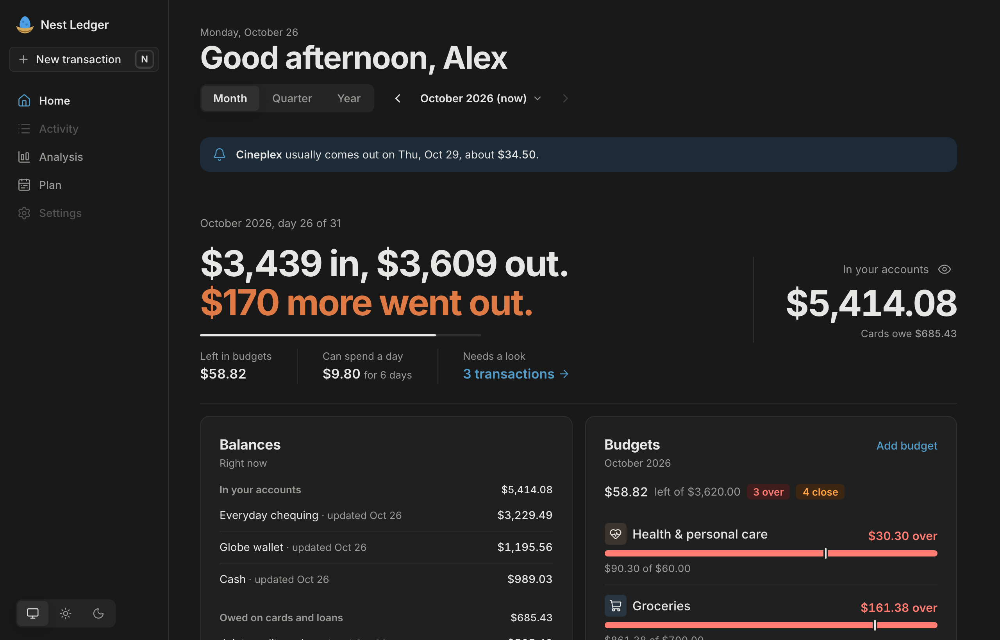

# Nest Ledger

A calm, private money notebook for one household. Every transaction from your bank and card accounts, sorted into buckets, with budgets, goals, bills coming up and where you stand, on your phone and your laptop.

You run your own copy: your own database and your own website, on free plans. Nobody else, including the people who make Nest Ledger, can see your money.

- **Quick:** add a purchase in seconds ("14.50 coffee"), split a receipt across buckets, see this month at a glance.
- **Shared:** everyone in the household signs in and sees the same numbers. Only people the owner invites can get in.
- **Yours to shape:** buckets, budgets, goals, accounts and even the dashboard cards are rows in your database, so you (or your AI agent) can change any of them without touching code.
- **AI without an AI bill:** your own Codex, Claude or ChatGPT can read statements and receipts and write the transactions, through your database's MCP connector. The app checks every number an agent writes.
- **Any currency, any calendar:** set your currency, how you write dates, and whether weeks start on Monday or Sunday.

<p align="center">
  
</p>
<p align="center">
  
  
</p>
<p align="center">
  
  
</p>

The screenshots show a made-up household.

## Set it up

- **By hand, no programming:** follow [docs/SETUP.md](docs/SETUP.md). About 10 minutes. It starts by forking [github.com/yusuftaleb/nest-ledger](https://github.com/yusuftaleb/nest-ledger).
- **With your AI agent:** open this folder in Claude Code, Codex or Gemini and say "set up Nest Ledger for me". It follows [AGENTS.md](AGENTS.md).

Updates: click **Sync fork** on your copy on GitHub; the website and database update themselves.

## For developers

Next.js 16 (App Router), React 19, Supabase (Postgres with row-level security), Tailwind v4. Start with [HANDOFF.md](HANDOFF.md).

```bash
cp .env.local.example .env.local   # fill in your Supabase project
npm install
npm run dev                        # http://localhost:3000, or /demo for a made-up household
```

Checks: `npx next typegen && npx tsc --noEmit`, `npm run lint`, `npm test`, `npm run build`.

## Licence

[GNU AGPL-3.0](LICENSE). You can use, change and share Nest Ledger freely. If you run a changed version for other people over a network, you must share your changes with them under the same licence.

See [PRIVACY.md](PRIVACY.md) for exactly what leaves your copy (almost nothing), [SECURITY.md](SECURITY.md) to report a problem, and [CONTRIBUTING.md](CONTRIBUTING.md) to help.

Nest Ledger is a notebook, not financial advice.
